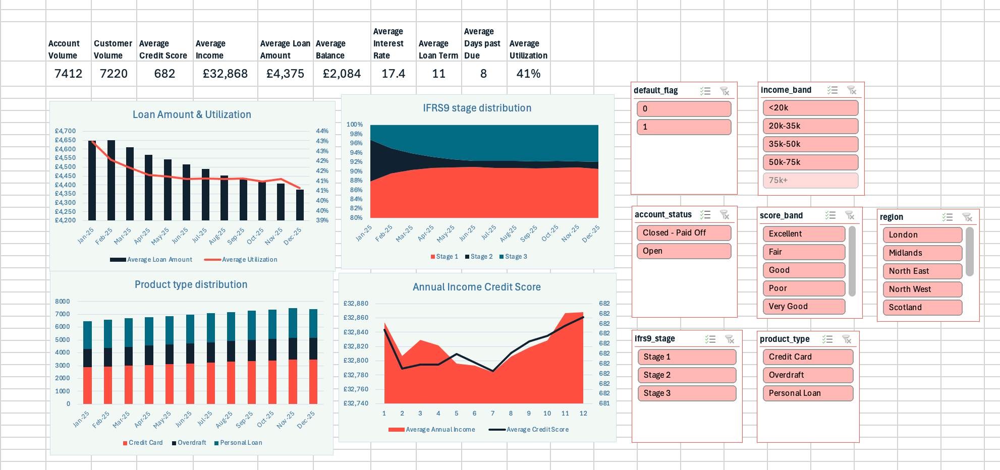

# Dashboard project (Excel)
 
An interactive Excel dashboard for monitoring a bank's unsecured lending portfolio (credit cards, personal loans and overdrafts) across 2025. Built end to end: synthetic data generation, a Power Query aggregation, pivot tables, and a slicer-driven dashboard.
 

<!-- Add a screenshot of the Dashboard tab here: Windows key + Shift + S, save into /screenshots -->
 
## Objective
 
Give a risk or portfolio manager a single view of how the unsecured book is performing: volumes, credit quality, pricing and arrears, with the ability to filter by product, region, credit score band, income band, IFRS 9 stage and account status.
 
## Tools & Skills
 
- **Excel**: pivot tables, calculated fields, slicers, charts, dashboard layout
- **Power Query**: grouping and aggregating the raw data (`Table.Group`)
- **Excel formulas**: `INT(YEARFRAC(...)*12)` for time on book
- **Data modelling**: designing realistic synthetic data with built-in trends
- **Banking concepts**: credit utilisation, APR, days past due, IFRS 9 staging, default flag
## The Data
 
The data is **synthetic**, generated with an AI assistant from a written prompt (the prompt is kept in the `Methodology` tab). Rules given for the data:
 
- About 5,000 customers, who can hold multiple accounts across different products
- 8,000 accounts, tracked as **monthly snapshots from Jan to Dec 2025** (84,098 rows in total)
- Built-in realistic trends, for example: lower credit scores lead to higher utilisation and higher APRs, and higher income leads to larger loan amounts
  
| Product | Account-month rows |
|---------|-------------------:|
| Credit Card | 38,316 |
| Personal Loan | 26,944 |
| Overdraft | 18,838 |
 
Regions covered: London, South East, North West, North East, Midlands, Wales, Scotland.
 
Every field is explained in the `Data Dictionary` tab (account, customer, product, score band, income band, utilisation, APR, days past due, IFRS 9 stage, default flag, and more).
 
## Workbook Structure
 
| Tab | What it contains |
|-----|------------------|
| `Methodology` | The original prompt, the time-on-book formula, the Power Query aggregation code, and how the summary statistics were calculated |
| `Data Dictionary` | Definition of every variable |
| `Data` | The raw account-level monthly snapshots (84,098 rows, 21 columns) |
| `Data Summary` | The Power Query output: data grouped by snapshot date, product, region, score band, income band, IFRS 9 stage, default flag and account status |
| `Pivot` | Pivot tables built on the aggregated data, connected to the slicers |
| `Summary` | Monthly summary statistics and the supporting charts |
| `Dashboard` | The final interactive view: KPI tiles, charts and slicers |
 
## How It Was Built
 
1. **Generated the data.** Wrote a detailed prompt describing the customers, products, snapshot period and the trends the data should contain.
2. **Calculated time on book** in the `Data` tab using `INT(YEARFRAC(origination_date, snapshot_date) * 12)`.
3. **Aggregated with Power Query.** Used `Table.Group` to roll the 84k rows up into a much smaller summary table, summing each measure and counting accounts and distinct customers. This keeps the workbook fast.
4. **Built pivot tables** on the aggregated table, with calculated fields that divide each measure by `account_volume` to give averages (average income, credit score, balance, loan amount, utilisation, term, days past due, time on book, APR).
5. **Designed the dashboard** with KPI tiles, charts and 7 slicers (product type, region, score band, income band, IFRS 9 stage, default flag, account status) that filter everything at once.
## Dashboard Contents
 
**KPI tiles:** account volume, customer volume, average credit score, average income, average loan amount, average balance, average interest rate, average loan term.
 
**Charts:**
- Product type distribution
- IFRS 9 stage distribution
- Loan amount and utilisation
- Annual income vs credit score
## Key Observations (synthetic data, Jan to Dec 2025)
 
- The book grew from **6,447 to 7,412 accounts**, with Credit Cards the largest product.
- Average utilisation fell slightly, from about **43.0% to 40.6%**.
- Average days past due crept up, from about **6.9 to 7.7 days**.
- Average credit score stayed stable at around **682** throughout the year.
## How to Use
 
1. Download `Unsecured_Portfolio_Dashboard.xlsx`
2. Open it in desktop Excel (slicers and Power Query need the desktop version; Excel for the web has limited support)
3. Go to the `Dashboard` tab and click the slicers to filter the view
4. To refresh after changing the data: **Data → Refresh All**
## Limitations & Possible Improvements
 
- Because the data is synthetic, the findings illustrate the techniques and do not reflect a real bank.
- The Power Query step counts distinct customers within each group, so adding those counts together across groups (as a pivot does) can overstate the true number of unique customers. A distinct count built in the Data Model (DAX) would fix this.
- Next steps: move the aggregation to SQL or Python, add a delinquency roll-rate view, and publish the dashboard in Power BI.
## What I Learned
 
- How to structure a dashboard workbook so raw data, aggregation, pivots and presentation stay separate
- Using Power Query to shrink a large dataset into something fast to pivot
- How calculated fields work in pivot tables, and their limits
- Core credit-risk metrics and IFRS 9 staging
- Why a data dictionary and methodology tab make a project easier for others to follow
---
 
*Part of my [Data Engineering Projects Portfolio](../README.md).*
 
